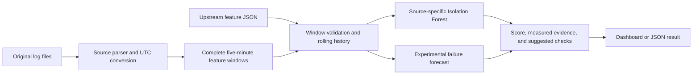

# Self-Healing Log Intelligence

**NBE Innovation Cycle 2026 · Pola Adolf and Youssef Atef**

Log Observatory turns original operational logs into five-minute summaries. It highlights unusual activity and gives operators the measurements and checks they need to investigate. The dashboard also displays experimental five- and fifteen-minute signals for recorded failures where a compatible forecast is available.

## Run the dashboard

Use Python 3.11 or newer and install the repository requirements in a virtual environment.

```powershell
python -m venv .venv
.\.venv\Scripts\python -m pip install -r requirements.txt
.\.venv\Scripts\python raw_log_service.py --data-dir tmp/dashboard_demo
```

On macOS or Linux, replace `.\.venv\Scripts\python` with `.venv/bin/python`.

1. Open [localhost:8765](http://localhost:8765).
2. Select Apache access, Apache error, IIS W3C access, or Windows Event Viewer.
3. Choose an original file for that source and select **Upload & analyze**.
4. Review coverage, the current anomaly percentile, supporting measurements, and suggested checks. **Export assessment** downloads the result as JSON.

To try the full upload flow, select **Apache access** and use the [synthetic Apache sample](examples/apache_demo.log). It covers 12 windows and demonstrates the workflow. Use your own approved logs to assess behavior on your system.

For a hosted rehearsal, see [GitHub Codespaces](MODEL_DELIVERY_GUIDE.md#run-in-github-codespaces). Use a private forwarded port and upload only files approved for that environment. The [demo guide](LIVE_DEMO.md) explains how to rehearse with supplied logs.

## Architecture



| Component | Role |
| --- | --- |
| [raw_log_service.py](raw_log_service.py) and [web/index.html](web/index.html) | Upload original logs, show results, and export assessments. |
| [build_corrected_dataset.py](build_corrected_dataset.py) | Parse sources and build feature windows for training. |
| [train_v2_models.py](train_v2_models.py) and [model_runtime.py](model_runtime.py) | Train source-specific detectors and score completed windows. |
| [failure_prediction.py](failure_prediction.py) | Train and evaluate experimental forecasts of future recorded errors. |
| [schemas](schemas/) | Define feature-window inputs and future incident labels. |

## Run the model on feature windows

```bash
python run_model_demo.py --source apache
python -m pip install pytest
python -m pytest tests -q
```

An upstream caller can send one completed window per invocation. Reuse the state file for successive calls and keep timestamps in sequence.

```bash
python model_runtime.py --input current_window.json --output prediction.json --state runtime_state.json
```

Scoring starts with 12 consecutive complete windows. A missing interval restarts the rolling history for that source. See the [model input contract](MODEL_INTERFACE.md) and [test guide](TESTING.md) for examples and expected results.

## Interpret the results

- **Current anomaly percentile.** The rank of the current behavior against training history. Compare it with the source's review threshold. The score does not measure outage probability.
- **Evidence and checks.** Measurements and suggested operator checks support investigation. Remediation requires a human decision.
- **Experimental forecasts.** The target is future recorded errors, including recurrence. The scores are uncalibrated. Confirmed incident prediction requires approved labels and evaluation on a later, untouched period.
- **Source coverage.** Four models were trained. Tomcat access and the supplied application logs were examined but excluded from model training. Timestamp assumptions and feature exclusions are documented below.

## Project reference

- [Dataset inventory](DATASET_INVENTORY.md), [feature catalog](FEATURE_CATALOG.md), and [timestamp policy](DATA_TIME_AND_FAILURE_POLICY.md)
- [Forecast evaluation](outputs_v2/failure_prediction_report.json), [model comparison](MODEL_EVALUATION.md) and [incident validation plan](INCIDENT_PREDICTION_PLAN.md)
- [Final presentation](output/presentations/NBE_Innovation_Cycle_2026_Final_Presentation.pptx)
- [Project report](output/pdf/NBE_Innovation_Cycle_2026_Self_Healing_Log_Intelligence_Report.pdf) and [Demo Day notes](DEMO_DAY_2026.md)
- [Extended delivery guide](MODEL_DELIVERY_GUIDE.md)
