# Self-Healing Log Anomaly Model

**Project team:** Pola Adolf and Youssef Atef.

**Original-log upload dashboard and observed-failure forecasting.** Run
`python raw_log_service.py` and open `http://localhost:8765`. See
[LIVE_DEMO.md](LIVE_DEMO.md) for the live presentation and raw-file API.
The dashboard calculates real results from uploaded logs; no simulated replay
is used. Experimental 5/15-minute failure forecasts are evaluated separately in
`outputs_v2/failure_prediction_report.json`. They predict recorded errors,
including recurrence, rather than confirmed incident onsets. The original
anomaly-only interface documented below is retained.

This repository contains the model component of a log-monitoring system. The
model receives one completed five-minute feature window, validates it, keeps the
last hour of history, and returns:

- a current anomaly status;
- a 0-100 anomaly percentile;
- evidence from the current window;
- diagnostic checks for an operator;
- a recommended action (`none` or `operator_review`).

The model does not collect raw logs, run Kafka or Filebeat, schedule jobs, or
restart services. Those responsibilities belong to the upstream application.

The saved model is a development model. It supports current anomaly detection
and experimental five- and fifteen-minute forecasts of future recorded failure
signals. Those forecast scores are not incident probabilities. Confirmed
incident-onset prediction remains unavailable until models trained on reviewed
incident labels pass the acceptance criteria.

## End-to-end flow

```mermaid
flowchart LR
    A[Logs] --> B[Completed 5-minute window]
    B --> C[Feature engineering]
    C --> D[Current anomaly detection]
    D --> E[0-100 anomaly score]
    E --> F[Explanation and contributing evidence]
    F --> G[Operational checks]
    G --> H[Experimental future failure signal]
    H -. Future phase with confirmed labels .-> I[Incident onset prediction]
```



The solid path is implemented in the current prototype. Confirmed incident-onset
prediction is a separate future phase. A synthetic label set may test that
pipeline, but only approved human-confirmed incidents and an untouched later
period can support production performance claims.

## Repository layout

```text
model_runtime.py             One-file inference CLI used by an upstream system
run_model_demo.py            Production-like file-flow smoke test
models_v2/                   Saved model bundle and model card
outputs_v2/                  Prepared features and development evaluation results
examples/                    Valid request examples for every trained source
tests/                       Automated parser, runtime, leakage, and scoring tests
build_corrected_dataset.py   Rebuilds the corrected five-minute feature tables
build_incident_targets.py    Builds leakage-safe 5/15-minute onset targets
train_v2_models.py           Retrains the source-specific model bundle
score_v2_system.py           Scores the prepared development datasets
MODEL_INTERFACE.md           Full request and response contract
TESTING.md                   Test and presentation procedure
PROJECT_ROADMAP.md           Current status, limitations, and production gates
FEATURE_CATALOG.md           Feature definitions, units, and reliability status
DATASET_INVENTORY.md         Supplied sources, record counts, and model status
DATA_TIME_AND_FAILURE_POLICY.md  UTC rules and failure-signal interpretation
INCIDENT_PREDICTION_PLAN.md  Synthetic-to-approved label and validation plan
schemas/                     Machine-readable feature-window and incident contracts
```

## 1. Install

Python 3.11 or 3.12 is recommended.

### Windows PowerShell

```powershell
py -m venv .venv
.\.venv\Scripts\Activate.ps1
python -m pip install --upgrade pip
python -m pip install -r requirements.txt
```

### Linux, macOS, or WSL

```bash
python3 -m venv .venv
source .venv/bin/activate
python -m pip install --upgrade pip
python -m pip install -r requirements.txt
```

Run every command below from the repository root.

## 2. Run the automated tests

```bash
python -m pytest tests -q
```

The expected result is:

```text
17 passed
```

## 3. Run the production-like smoke test

```bash
python run_model_demo.py
```

This test selects 12 consecutive real Apache windows and writes 12 separate
request files. It loads the model once, like a long-running production worker,
and uses the same state file across all calls. This simulates a completed input
file arriving every five minutes without waiting one real hour.

Expected behavior:

- files 1-11 return `awaiting_history`;
- file 12 returns `within_learned_range` or `unusual`;
- the final response contains the score, evidence, checks, and action;
- the temporary request, response, and state files are removed automatically.

Run the same test with any trained source:

```bash
python run_model_demo.py --source iis
python run_model_demo.py --source apache_error
python run_model_demo.py --source windows_eventviewer
```

To test the exact cold-start CLI path with a new Python process for every file,
run the slower mode:

```bash
python run_model_demo.py --mode cli
```

See [TESTING.md](TESTING.md) for the complete presentation procedure.

Feature definitions and reliability decisions are documented in
[FEATURE_CATALOG.md](FEATURE_CATALOG.md). The future prediction design is in
[INCIDENT_PREDICTION_PLAN.md](INCIDENT_PREDICTION_PLAN.md).
The complete source and training inventory is in
[DATASET_INVENTORY.md](DATASET_INVENTORY.md).
The verified and assumed UTC rules, plus the distinction between failure
signals and incident labels, are in
[DATA_TIME_AND_FAILURE_POLICY.md](DATA_TIME_AND_FAILURE_POLICY.md).

## 4. Presentation and live demonstration

- [Project presentation](output/presentations/NBE_Innovation_Cycle_2026_Model_Journey_Team_Edition.pptx)
  explains the EDA, data cleaning, feature engineering, model choices,
  comparisons, measured results, current use, and next phase.
- [Captioned live-demo video](output/video/NBE_Innovation_Cycle_2026_Live_Demo.mp4)
  shows the dashboard with English on-screen explanations.
- [Live demo instructions](LIVE_DEMO.md) explain how to start the dashboard and
  upload original logs from the supplied archive.

## 5. Production file flow

The upstream system must aggregate raw logs into one completed five-minute
window. When the file is ready, it invokes the model once:

```bash
python model_runtime.py \
  --input incoming/current_window.json \
  --output outgoing/current_prediction.json \
  --state runtime_state.json
```

The same `runtime_state.json` path must be reused for every call. It stores the
last 12 windows for each source. Calls that share one state file must be
serialized; do not start two model processes against the same state file at the
same time.

The upstream integration should follow this sequence every five minutes:

1. Close the five-minute aggregation window.
2. Calculate the required features for one `source_model`.
3. Write the complete JSON to a temporary filename.
4. Rename it atomically to the final input filename.
5. Invoke `model_runtime.py` with the persistent state file.
6. Read the output JSON and route it according to `current_status`.
7. Archive the input and output with their timestamps for audit purposes.

The first 11 consecutive windows are warm-up history. A missing five-minute
window resets that source's history and returns `awaiting_history_after_gap`.
Duplicate and out-of-order windows are rejected.

## 6. Input file structure

Each input file must contain exactly one completed five-minute window:

```json
{
  "source_model": "apache",
  "window_start": "2026-09-17T10:00:00Z",
  "window_end": "2026-09-17T10:05:00Z",
  "window_complete": true,
  "features": {
    "apache_request_count": 200,
    "apache_2xx_count": 180,
    "apache_bytes_sent": 85000,
    "apache_4xx_count": 15,
    "apache_5xx_count": 5,
    "apache_3xx_count": 0
  }
}
```

The machine-readable contract is
[`schemas/feature_window.schema.json`](schemas/feature_window.schema.json).

Envelope rules:

| Field | Rule |
|---|---|
| `source_model` | One of the trained source names below |
| `window_start` | Inclusive start of the window |
| `window_end` | Exactly five minutes after `window_start` |
| `window_complete` | Must be JSON boolean `true` |
| `features` | Must contain every feature required for that source |

All feature values must be JSON numbers, finite, and greater than or equal to
zero. Do not send numeric strings such as `"5"`. A real observed zero is `0`;
missing data must not be converted to zero. Send a window only after the
upstream collector has confirmed that the source coverage is complete.

### Apache

`source_model`: `apache`  
Time basis: UTC with `Z` or an explicit UTC offset.

Required features:

```text
apache_request_count
apache_2xx_count
apache_bytes_sent
apache_4xx_count
apache_5xx_count
apache_3xx_count
```

Example: [examples/apache_window.json](examples/apache_window.json)

### IIS

`source_model`: `iis`  
Time basis: UTC with `Z` or an explicit UTC offset. Response times are
milliseconds.

Required features:

```text
iis_request_count
iis_2xx_count
iis_response_ms_max
iis_5xx_count
iis_3xx_count
iis_4xx_count
iis_avg_response_ms
```

Example: [examples/iis_window.json](examples/iis_window.json)

### Apache error log

`source_model`: `apache_error`  
Time basis: UTC. The source text has no timezone suffix, so the project policy
explicitly interprets those timestamps as UTC and records that assumption in
the audit outputs.

Required features:

```text
record_count
warn_count
error_count
notice_count
info_count
information_count
warning_count
```

Example: [examples/apache_error_window.json](examples/apache_error_window.json)

### Windows Event Viewer

`source_model`: `windows_eventviewer`  
Time basis: UTC. The export has no timezone suffix, so the project policy
explicitly interprets those timestamps as UTC and records that assumption in
the audit outputs.

The required features are the same seven event-count features listed for the
Apache error-log model.

Example: [examples/windows_eventviewer_window.json](examples/windows_eventviewer_window.json)

## 7. Test with your own data

Copy the closest example and replace its timestamp and feature values. Start a
new test with a new state filename:

```bash
python model_runtime.py \
  --input my_window_01.json \
  --output my_prediction_01.json \
  --state my_test_state.json
```

Create 12 files with consecutive five-minute timestamps and invoke the command
for each file in timestamp order, always reusing `my_test_state.json`. The first
11 outputs should report `awaiting_history`. The twelfth output should contain
the current anomaly assessment.

For a second independent test, use a different state filename. Do not reuse
production state for experiments.

## 8. Output interpretation

The final response has this form:

```json
{
  "model_version": "2.1.0-development",
  "source_model": "apache",
  "time_basis": "UTC",
  "window_start": "2026-09-17 10:00:00+00:00",
  "window_end": "2026-09-17 10:05:00+00:00",
  "current_status": "within_learned_range",
  "current_anomaly_score": 81.09,
  "score_definition": "Training-history anomaly percentile; not a failure probability.",
  "evidence": ["apache_request_count=200", "apache_5xx_count=5"],
  "recommended_checks": ["Review matching server errors before considering a restart."],
  "recommended_action": "none",
  "forecast_score_5m": null,
  "forecast_status_5m": "not_available",
  "forecast_score_15m": null,
  "forecast_status_15m": "not_available"
}
```

`within_learned_range` means the window is within the learned historical range.
`unusual` means it is outside that range and should be reviewed by an operator.
It does not prove a service failure.

The anomaly score is a percentile of anomaly extremeness against the training
history. A score of 81.09 is not an 81.09% probability of failure.

The current model never performs an automatic restart or remediation action.
Forecast fields are populated only when a compatible experimental forecast
model and complete history are available. They are uncalibrated development
signals for future recorded failures, not probabilities of a confirmed
incident. Sources that lack enough history or validation events continue to
return `not_available`.

## 9. Optional rebuild and retraining

The saved model and prepared feature tables are already included. Rebuilding is
not required for inference.

To rebuild from the original supplied log archive, extract `Project Logs.rar`
into a `Project Logs` directory, then run:

```bash
python build_corrected_dataset.py --input "Project Logs" --output outputs_v2
python train_v2_models.py
python score_v2_system.py
```

Review `outputs_v2/data_quality_report.md`,
`outputs_v2/v2_development_metrics.csv`, and `models_v2/model_card.json` before
using a newly trained bundle.

## 10. Current production gates

Before claiming future-incident prediction or unattended remediation, the
project still requires:

- human-confirmed incident start and end labels;
- an untouched later evaluation period;
- source-owner confirmation of the documented assumed-UTC mappings;
- a documented unit for the excluded Apache latency field;
- reviewed runbooks, approvals, health checks, and rollback procedures.

See [PROJECT_ROADMAP.md](PROJECT_ROADMAP.md) for details.

## 11. Synthetic incident-pipeline check

The included dummy incidents can exercise target construction without waiting
for approved incident data:

```bash
python build_incident_targets.py \
  --labels examples/dummy_incidents.json \
  --label-status synthetic \
  --source apache \
  --output outputs_v2/dummy_incident_targets.csv
```

This produces leakage-safe 5-minute and 15-minute onset targets and excludes
windows where an incident is already active. The output is a pipeline test only.
It must not be presented as incident-prediction accuracy.
