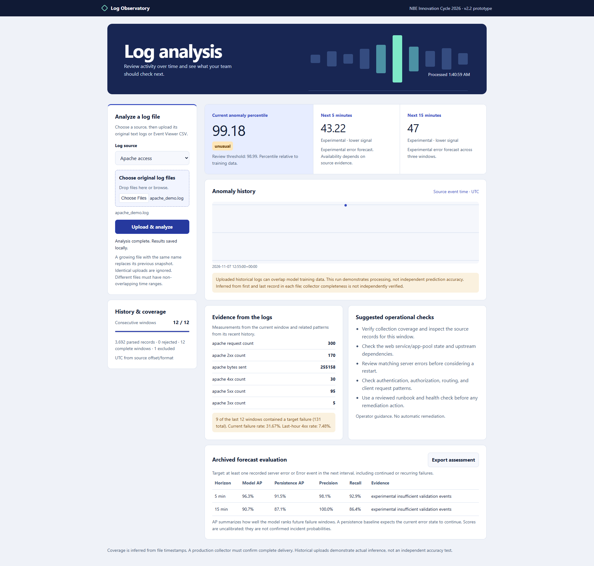
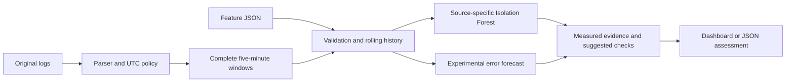

# Self-Healing Log Intelligence

Operational log analysis for investigating unusual service behavior.

[](https://github.com/PolaAdolf/self-healing-log-intelligence/actions/workflows/tests.yml)

**Development prototype, release 2.2**  
NBE Innovation Cycle 2026 · Pola Adolf and Youssef Atef



Upload supported original logs, inspect unusual activity, and review measured evidence and suggested checks. Four source-specific detectors cover Apache access, Apache error, IIS W3C and Windows Event Viewer. Upstream systems can also supply validated feature-window JSON.

Anomaly percentiles are not outage probabilities. Only Apache access exposes experimental forecasts of future recorded errors. Confirmed incident prediction is not validated, and automatic remediation is not implemented. Read the [current status](STATUS.md) before operational evaluation.

## Quick start

Use Python 3.11 or 3.12. From the repository root:

```bash
python -m venv .venv
# Windows: .venv\Scripts\activate
# macOS / Linux: source .venv/bin/activate
python -m pip install -r requirements.txt
python raw_log_service.py --data-dir tmp/dashboard_demo
```

Open [localhost:8765](http://localhost:8765), select **Apache access**, choose [`examples/apache_demo.log`](examples/apache_demo.log), and click **Upload & analyze**. The synthetic sample demonstrates processing, not prediction accuracy.

Scoring needs 12 consecutive complete five-minute windows. A missing interval restarts context. The sample already contains the required hour of history. Uploaded files stay in the selected local data directory.

For hosted evaluation, follow [GitHub Codespaces](docs/MODEL_DELIVERY_GUIDE.md#run-in-github-codespaces). Keep the forwarded port private and use approved data.

## Architecture



An operator decides what to investigate or change. Collection, scheduling and production access control remain integration responsibilities.

## Verify and package

```bash
python -m pip install -r requirements-dev.txt
python -m pytest tests -q
python run_model_demo.py --source apache
python package_live_delivery.py
```

The package command creates a checked ZIP under `release/`. See [testing](docs/TESTING.md) and the [model contract](docs/MODEL_INTERFACE.md).

## Repository guide

| Location | Purpose |
| --- | --- |
| Root Python modules | Runtime, service, training and evaluation commands |
| `web/` | Dashboard interface |
| `models_v2/` | Model bundles, model card and checksums |
| `schemas/`, `examples/` | Input contracts and synthetic examples |
| `tests/` | Parser, history, leakage and scoring checks |
| `outputs_v2/` | Prepared features and retained evaluation evidence |
| `docs/` | Integration, methodology, limitations and presentation |
| `tools/` | Presentation authoring tools |

[Documentation](docs/README.md) · [PowerPoint](docs/presentations/NBE_Innovation_Cycle_2026_Conference_Deck.pptx) · [PDF](docs/presentations/NBE_Innovation_Cycle_2026_Conference_Deck.pdf) · [Release evidence](docs/MODEL_RELEASE_2_2.md)

## Rights

All rights reserved. Public access does not grant an open-source license. See [LICENSE](LICENSE). Only load model artifacts from a source you trust; see the [model trust guidance](docs/MODEL_DELIVERY_GUIDE.md#model-artifact-trust).
